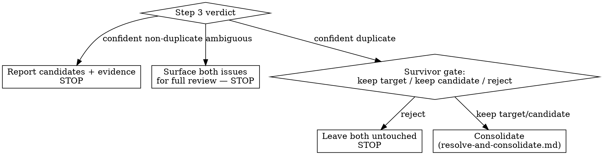

# Issue Triage

Given one issue, find out whether the tracker already holds a genuine duplicate of it, and if
so consolidate rather than leave both sitting open. Invoked manually against a specific issue
— this skill does not listen for GitHub events; it is a Claude Code skill, not a webhook
handler.

**Standing rule:** whether a candidate is a genuine duplicate is a finding —
`rr-workshop:defending-findings` applies. Superficial wording overlap is not evidence of a
duplicate; the same underlying request or bug is.

## Branches



## Why the ask can't be skipped

Consolidation is judgment applied under pressure — a long candidate list, an impatient user, a
"these are basically the same" feeling — and that pressure produces predictable shortcuts.
None of these change the rule: nothing merges or closes until the user has explicitly chosen
at the **survivor gate** (step 4).

| Excuse | Reality |
|--------|---------|
| "The wording match is obvious, no need to ask" | Wording overlap is exactly what the standing rule says isn't evidence — ask anyway. |
| "The user already implied which one to keep" | An implication isn't the three-way choice (target / candidate / reject) — get the explicit answer. |
| "Asking slows things down, I'm confident" | Confidence isn't the check; the survivor gate exists because a confident wrong merge closes an issue that shouldn't be closed. |
| "This is basically a duplicate, close enough" | "Basically" is the ambiguous verdict — route it there, don't upgrade it to confident. |
| "I'll merge now and let the user undo it if wrong" | Closing and cross-linking isn't reversible-by-default the way asking first is; nothing changes until the answer exists. |

## Steps

### 1. Gather the target issue

If no issue number or URL was given, ask for one before continuing. Fetch its title and body:

```bash
gh issue view <n> --json number,title,body,state
```

### 2. Search for candidates

Extract the salient terms from the target's title and body (the noun phrases describing the
actual request or bug, not incidental words), then search the tracker's other open issues:

```bash
gh api -X GET search/issues -f q='repo:{owner}/{repo} is:issue is:open <salient terms>' --jq '.items[] | {number, title}'
```

Exclude the target issue itself from its own candidate list. Read each candidate's full body,
not just its title — a title alone is not enough evidence either way. Done searching when the
salient-terms query has run and — if it returned zero candidates — at least one alternate
phrasing (a synonym, or the literal error text) has also been tried before concluding no
candidates exist.

### 3. Judge each candidate as a defended finding

For the strongest candidate (if any): build the positive case that it describes the *same*
underlying request or bug as the target — not merely similar words, the same problem or ask —
then attack that case (could this be two different people independently hitting a similar-
sounding but distinct issue? does one mention a detail the other contradicts?). The claim only
stands if it survives that attack, cited with the specific evidence that forces it.

Reach one of three verdicts:

- **Confident duplicate** — the case survives attack, cited with its evidence. Continue to
  step 4, the survivor gate.
- **Confident non-duplicate** — no candidate's case survives attack. Report which candidates
  were considered and the specific evidence that killed each. **Stop here — no further action.**
- **Ambiguous** — evidence exists on both sides and neither reading clearly wins. Surface the
  target and the closest candidate side by side to the user for full review, explicitly
  presenting the case for and against rather than picking one. **Stop here — no automatic
  action either way.**

### 4. The survivor gate — only for a confident duplicate

See [resolve-and-consolidate.md](resolve-and-consolidate.md) for resolving the survivor with
the user and consolidating.

## Red flags — STOP

- Treating superficial wording overlap as sufficient evidence of a duplicate.
- Picking a survivor by an automatic rule (filing order, more detail, anything) instead of the
  survivor gate.
- An ambiguous verdict resolving itself into an automatic action instead of full human review.

## Done when

- [ ] A confident non-duplicate verdict named its candidates and the evidence that killed each.
- [ ] An ambiguous verdict surfaced both issues for full review instead of acting automatically.
- [ ] A confident duplicate went through the survivor gate in `resolve-and-consolidate.md` in full.
